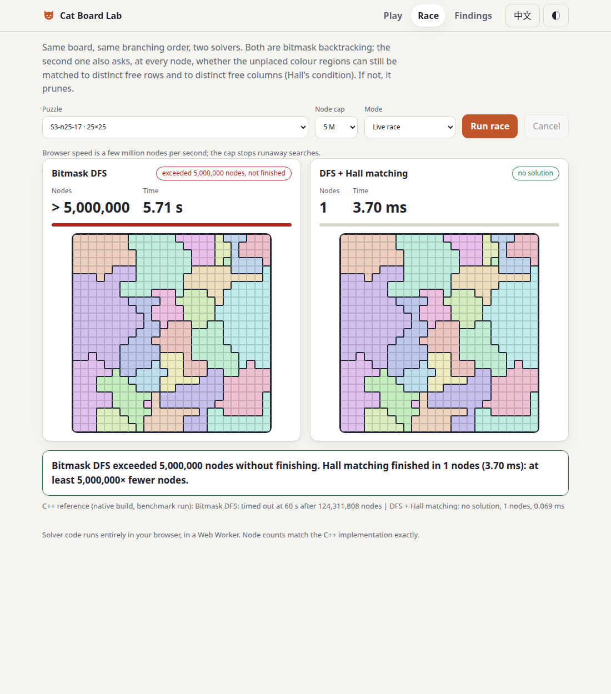
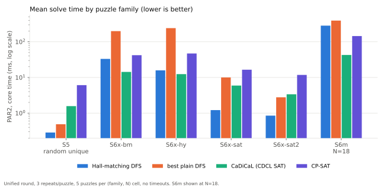
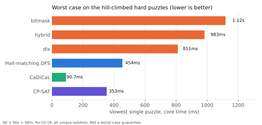
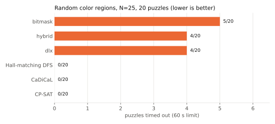
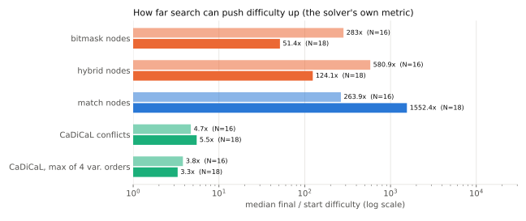

# Which algorithm should solve a cat-placement puzzle?

A controlled benchmark of five solver families on "one per row, column and region, no two touching" puzzles (the Queens / Star Battle family), with adversarial puzzles, same-language native cores, and independently reviewed conclusions.

**Live demo:** https://jadiouo.github.io/cat-puzzle-solvers/



**In one minute**

- **Question:** for this puzzle family, is it better to use human-style reasoning plus search, exact cover (DLX), or an off-the-shelf SAT / CP solver?
- **Answer (for this batch of puzzles and these implementations):** no single winner. A backtracking search with one extra counting rule (Hall matching) is fastest on ordinary puzzles. CDCL SAT (CaDiCaL) is the steadiest on the hardest puzzles I could generate.
- **Why the plain DFS lost earlier:** it was missing Hall-style counting reasoning, not "DFS" as an idea. Adding it removed every timeout on the main suites.
- **Not a proof:** this is a measured comparison between implementations, with stated limits (see [Limitations](#limitations)).

## Why

Place one cat in every row, every column and every colored region, so that no two cats touch (diagonals included). Deciding whether such a puzzle is solvable is NP-complete (Minevich et al., [arXiv:2411.02251](https://arxiv.org/abs/2411.02251), for the closely related Parks / Queens variant), yet instances of this kind are everywhere.

So which algorithm should you actually use? Human-style propagation plus backtracking, exact cover with Dancing Links, and SAT / CP solvers all sound plausible, and each is usually benchmarked in a different language on different puzzles. I wanted a comparison where the answer is about the *algorithm*, and where the puzzles are chosen to hurt each method.

## Method

**Five method families**, all with native (C++) cores:

| Family | What it is |
|---|---|
| bitmask DFS | Backtracking over row bitmasks with MRV branching and forward checking |
| hybrid propagation | The same DFS plus human-style propagation rules at every node |
| DLX | Dancing Links exact cover, with secondary columns for the no-touch rule |
| Hall-matching DFS (`match`) | Bitmask DFS plus a Hall check at each node: the regions that still need a cat must be assignable to distinct free rows, and to distinct free columns (bipartite perfect matching). If not, prune |
| CDCL SAT / CP-SAT | Exactly-one constraints per row, column, region plus no-touch clauses; CaDiCaL, Glucose, MiniSat via PySAT, and OR-Tools CP-SAT |

**Fairness controls**

- **Same language for the core.** DFS variants are C++ (`native/cat_native.cpp`); the SAT and CP-SAT solvers are C/C++ libraries. Python only builds the model.
- **Faithful ports.** The C++ bitmask, hybrid and DLX solvers walk the same search tree as the Python originals. The tests check per-puzzle node-count equality (948/948 identical in my test run).
- **Two timing definitions.** *core* is the native solve time (SAT: the solver call only). *e2e* adds model building. Charts here use core; e2e is in `bench/results/final_native_tables.md`.
- **PAR2.** The mean over all puzzles, where a timeout counts as 2 x the time limit. It does not hide timeouts the way a median of finished runs does.
- **Times are only compared within one round.** The main comparison (`unified_*`) ran every method on the same puzzles in the same round under similar load (load 2-9). Earlier rounds ran under heavier load (10-44) and are not mixed in.
- **Language-independent work metrics.** Nodes (DFS) and conflicts (SAT) are unaffected by machine load.

**Puzzle suites**

- Random puzzles with 0, 1 or many solutions (S1-S4, up to N=25) and random unique-solution puzzles (S5, S5b, N=11-16).
- **Adversarial suites** built by hill climbing, changing one cell's color at a time (about 55-60 s per puzzle), to maximize a chosen solver's own cost: S6 and S6x target bitmask nodes, hybrid nodes, or CaDiCaL conflicts; S6m targets the Hall-matching solver. All adversarial puzzles have a unique solution.

**Correctness.** 652 independent puzzles. Every result that finished matches the reference answer: 0 MISMATCH, 0 ERROR. The reference is an independent exhaustive solver where one exists; otherwise the SAT and CP-SAT solvers must agree. Part of the reference therefore comes from solvers under test, so it is not fully independent. Timeouts are counted separately (0 in the unified comparison).

**Adversarial review.** Each round of conclusions was handed to an independent reviewer instructed to attack it, and the claims were corrected. One example: I had written that the gap between `match` and CaDiCaL was "a constant 7x" because both grew about 7-8x from N=14 to N=18. That compares each method's growth with itself, not the gap between them. The actual per-N ratios are 0.7, 5.9, 2.5, 6.6, so the report now says the advantage is not monotonic in N.

## Results

Two conclusions (from [`research/solver-conclusion.md`](research/solver-conclusion.md)):

1. **Ordinary puzzles: backtracking with Hall-matching pruning is fastest.** On random unique-solution puzzles (S5, S5b, N=11-16) it takes about 0.3 ms PAR2 against 1.2-1.6 ms for SAT. On random-region puzzles at N=25 (20 puzzles, 13 unsolvable, 60 s limit) it solves all 20, the slowest in 0.01 s, while the three plain DFS variants time out on 4-5.
2. **Worst puzzles found: CDCL SAT is steadiest.** On the hill-climbed puzzles (N=10-18) the slowest single puzzle takes 76-91 ms for SAT, 454 ms for `match`, and 0.8-1.1 s for plain DFS. Hill climbing raises DFS node counts by tens to thousands of times, but raises the median SAT conflict count only 3-5 times (single puzzles up to 14-58 times). This is not a worst-case guarantee.

**Key finding: the missing piece was Hall reasoning.** An earlier result said "SAT wins on big boards, DFS times out". The cause turned out to be that plain DFS has no counting (Hall) inference. Adding the matching check cut S1-S4 classify timeouts from 8-9 to 0, and on S3 cut node counts by a median of 3x (at most 3.4 x 10^6 x). My inference is that CDCL learns similar reasoning through clause learning, which would explain why it needs no hand-written pruning; I did not test this directly.

**Which to use**

- Default to `match`: 4-5x faster on ordinary puzzles.
- Use CDCL (CaDiCaL) if N >= 14 and puzzles may be adversarial, or if you want a solver that stays robust without designing your own pruning.
- In this data, the slowest puzzle for either took under 0.5 s.

### Mean solve time by puzzle family



### Worst single puzzle on the adversarial suites



### Timeouts on large random boards



### How far hill climbing pushes each solver's own difficulty metric



Each method is measured in its own unit (DFS nodes, SAT conflicts), so compare the sizes of the pushes, not the absolute values.

### Summary table

PAR2, core time. Bold = best, shown only where the best is at least 1.5x better than the next. S6x-hy is a tie between `match` and CaDiCaL (1.27x apart). Rows 1-6 come from the same unified round.

| Puzzle family | `match` | best plain DFS | CaDiCaL | CP-SAT |
|---|---|---|---|---|
| S5 random unique | **0.3 ms** | 0.5 ms (hybrid) | 1.6 ms | 6.1 ms |
| S6x targeting bitmask (N=16/18) | 33 ms | 200 ms (hybrid) | **14 ms** | 42 ms |
| S6x targeting hybrid | 16 ms | 242 ms (dlx) | 12 ms | 47 ms |
| S6x targeting SAT (sat / sat2) | **1.2 / 0.9 ms** | 10 / 2.8 ms | 5.9 / 3.4 ms | 17 / 12 ms |
| S6m targeting `match` (N=18) | 284 ms | 394 ms (dlx) | **43 ms** | 145 ms |
| Worst single adversarial puzzle | 454 ms | 811 ms | **91 ms** | 353 ms |
| S3 N=25 timeouts (60 s) | **0/20** | 4/20 | **0/20** | **0/20** |

`match` versus CaDiCaL on S6m: the time ratio is 0.7x at N=12 (`match` faster), then 5.9x, 2.5x and 6.6x at N=14, 16, 18. The SAT advantage appears from N=14 and is not monotonic; with 5 puzzles per cell I cannot say whether it grows with N.

Counting all solutions is deliberately not compared: at large N every method fails to enumerate (one N=14 puzzle has 15,620,263 solutions).

## Limitations

- **Board sizes:** unique-solution puzzles only reach N=18; random-region puzzles reach N=25.
- **Small samples:** 5 puzzles per (suite, N) cell, so extremes are unstable. Gaps under 1.5x are not ranked.
- **No UNSAT adversary.** All hard puzzles have a unique solution. Hall violations are essentially pigeonhole-style unsatisfiability proofs, and resolution needs exponential size for pigeonhole in theory. SAT's real worst case may sit in unsatisfiable puzzles this batch did not test.
- **One adversary.** Every hard puzzle came from the same one-cell hill climb. SAT's objective (CaDiCaL conflicts; for sat2, the max over 4 variable orders) may be harder to climb than DFS node counts, so "SAT only gets pushed 3-5x" does not mean SAT is hard to attack.
- **Implementation dependence.**
  - Hybrid costs about 1.5 us per node because this implementation recomputes propagation at every node; an incremental version could be faster.
  - Randomized-restart variants (`native_rr`, `match_rr`) got worse here (for example about 2.9 s for `match_rr` on S6m).
  - SAT was tested mainly with one model (exactly-one per row, column and region plus no-touch clauses). Five at-most-one encodings were compared only on S3 N=25: no timeouts, but the slowest puzzle varied 50x (pairwise 0.55 s, ladder 0.011 s).
- **Noise:** formal runs happened at load 10-44, the unified run at load 2-9. Times from different rounds are not comparable; node and conflict counts are.
- The comparison is between implementations in one language family, not a complexity proof.

## Reproduce

```bash
# 1. Build the native solvers (needs g++, C++17)
make -C native

# 2. Python environment for the SAT / CP-SAT solvers
python3 -m venv .venv
.venv/bin/pip install -r bench/requirements-sat.txt

# 3. Tests (standard library only for most; SAT tests need the venv packages)
python -m unittest discover -s tests -q

# 4. Unified comparison (long: five suites, nine solvers, 3 repeats each)
bench/run_unified.sh

# 5. Charts (system python3 with matplotlib; prints every plotted number)
python3 bench/make_charts.py
```

`make -C native` and the test suite (120 tests, 7 skipped) were run on the repository as published. `run_unified.sh` takes a long time and was not re-run for this README; its output lives in `bench/results/unified_*.csv`. Hill-climb generators: `bench/build_s6x.py`, `bench/build_s6m.py`.

## Repository layout

```
native/        C++ solvers: bitmask, hybrid, DLX, Hall-matching, restart variants
bench/         benchmark runner, SAT / CP-SAT models, suite builders, results/, make_charts.py
research/      solver-conclusion.md (final report), solver-algorithms.md (literature notes)
cat_solver/    the original CLI solver and generator (see cat_solver/README.md)
levelgen/      graded puzzle generator
tests/         unit tests
docs/          demo page and chart assets
prototype/, playtest/   early game prototypes, not part of the research
```

Research notes are written in Traditional Chinese; this README summarizes them. [繁體中文版](README.zh-TW.md)
