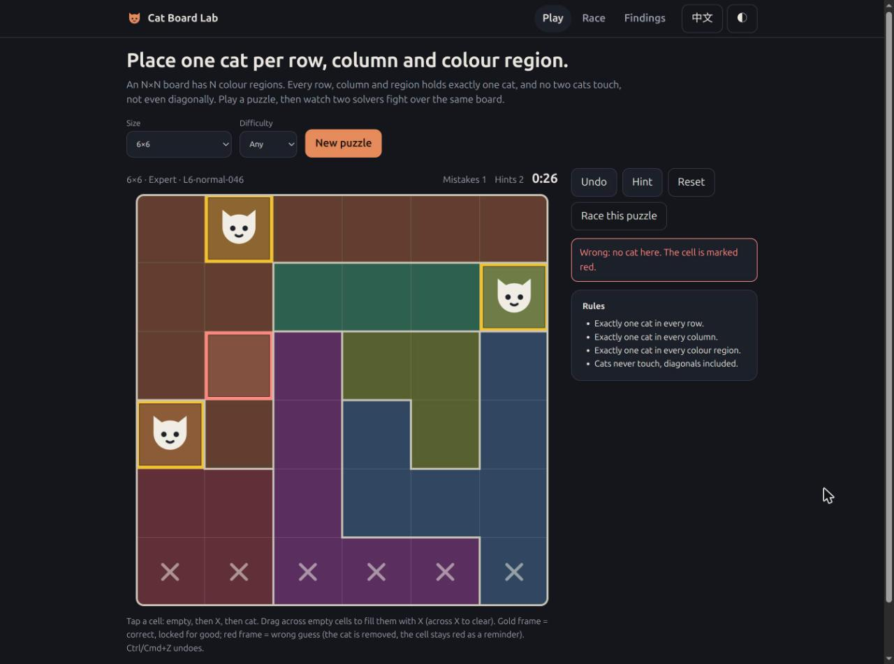
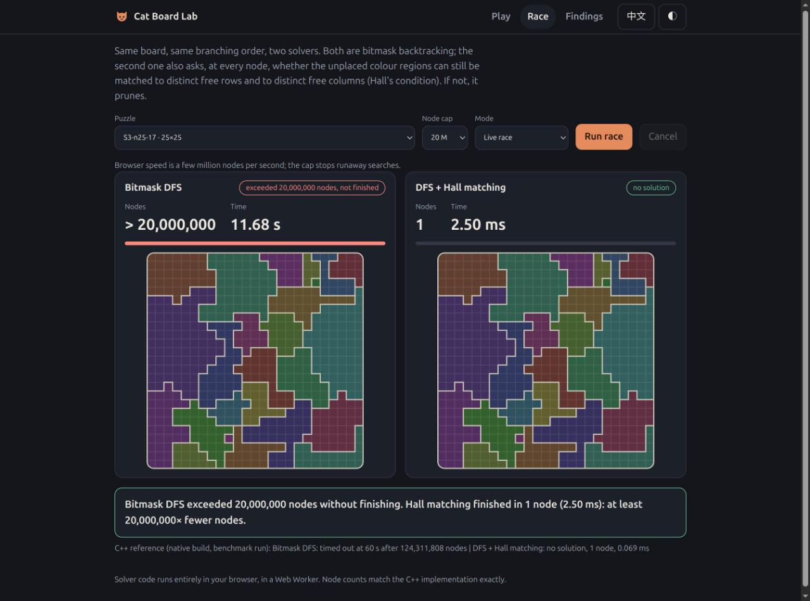

# 貓咪棋盤題：哪個求解演算法最好？

一個個人專案：我比較了五類演算法解「每列、每欄、每區各放一隻、彼此不可相鄰」謎題（Queens / Star Battle 同一族）的表現，生成了專門刁難各方法的題目，也做了一個網頁 demo，可以自己玩，也可以看兩個求解器在同一盤上對決。

**線上展示：** https://jadiouo.github.io/cat-puzzle-solvers/

| 試玩：金框＝放對並鎖定，紅框＝猜錯，拖曳可標 X | 對決：同一個 25×25 盤面，一般 DFS 對上 DFS＋Hall 檢查。這盤無解：Hall 檢查在根節點就證明了（1 個節點），一般 DFS 搜了 2000 萬個節點還沒做完 |
|---|---|
|  |  |

**一分鐘版**

- **問題：** 這類題目該用人類式推理＋搜尋、精確覆蓋（DLX），還是現成的 SAT / CP 求解器？
- **答案（限於本批題目與這些實作）：** 沒有單一贏家。回溯搜尋只要多加一條計數規則（Hall 匹配），在一般題上最快；CDCL SAT（CaDiCaL）在我能生成的最難題上最穩。
- **先前為什麼 DFS 輸：** 缺的是 Hall 式計數推理，不是 DFS 這個框架。白話說：如果還沒放貓的三個色區，加起來只能用到兩個空列，這條分支一定無解，馬上放棄。加上這一個檢查，S1–S4 題組（classify 模式）的超時全部消失。
- **這不是證明：** 這是實作之間的實測比較，限制見[限制](#限制)。

## 我做了什麼

這是一份工程研究，不是學術論文：沒有提出新演算法，也沒有定理，而是用仔細的實驗回答一個問題。

- **六個 C++ 原生求解器**（`native/cat_native.cpp`）：bitmask DFS、混合傳播、Dancing Links、Hall 匹配 DFS，以及兩個隨機重啟版本，共用同一個批次介面。
- **SAT 與 CP-SAT 建模**（`bench/solver_sat.py`）：給 CaDiCaL、Glucose、MiniSat（經由 PySAT）用的 exactly-one 與不相鄰編碼、五種 at-most-one 編碼，以及 OR-Tools CP-SAT 模型。
- **評比框架**（`bench/`）：題組、各求解器的時間上限、PAR2、重複執行、CSV 輸出與圖表。
- **刁難題生成器**（`bench/build_s6x.py`、`bench/build_s6m.py`）：用爬山法一次改一格顏色，把指定求解器自己的工作量推到最高。
- **正確性檢查**：652 題不重複的題目都和參考答案交叉比對；C++ 移植版逐題比對節點數，與 Python 原版一致。
- **互動 demo**（`docs/`）：純 JavaScript，不需要建置。試玩模式在每次放貓時立刻判定對錯；對決模式在 Web Worker 裡跑兩個 DFS，節點數與 C++ 版完全相同。

## 為什麼做這個研究

每列、每欄、每個色區各放一隻貓，任兩隻貓不能相鄰（含斜角）。判定這類題目是否有解是 NP-complete（Minevich 等人，[arXiv:2411.02251](https://arxiv.org/abs/2411.02251)，針對相近的 Parks / Queens 變體），但這類題目非常常見。

那實際上該用哪種演算法？人類式傳播加回溯、Dancing Links 精確覆蓋、SAT / CP 求解器聽起來都合理，但通常是在不同語言、不同題目上各自測的。我想做一個比較「演算法本身」的實驗，而且題目要刻意挑會讓各方法吃苦頭的。

## 方法

**五類方法**，核心全部是原生碼（C++）：

| 類別 | 內容 |
|---|---|
| bitmask DFS | 以列為單位的 bitmask 回溯，MRV 分支＋forward check |
| hybrid propagation | 同一個 DFS，每個節點再套人類式傳播規則 |
| DLX | Dancing Links 精確覆蓋，不相鄰規則用 secondary 欄 |
| Hall 匹配 DFS（`match`） | bitmask DFS，每個節點多檢查：還沒放貓的色區要能分到互不相同的空列，也要能分到互不相同的空欄（二分圖完美匹配）；做不到就剪枝 |
| CDCL SAT / CP-SAT | 列／欄／區 exactly-one 加相鄰禁止；CaDiCaL、Glucose、MiniSat（PySAT）與 OR-Tools CP-SAT |

**公平性做法**

- **核心同語言。** DFS 類是 C++（`native/cat_native.cpp`），SAT 與 CP-SAT 本身是 C/C++ 函式庫，Python 只負責建模。
- **忠實移植。** C++ 的 bitmask、hybrid、DLX 與 Python 原版走同一棵搜尋樹，測試逐題檢查節點數相等（我的測試執行為 948/948 相同）。
- **兩種計時口徑。** *core* 是原生求解時間（SAT 只算求解器呼叫）；*e2e* 再加上建模時間。本頁圖表用 core，e2e 在 `bench/results/final_native_tables.md`。
- **PAR2。** 對全部題目取平均，超時的題算 2 倍時限。不會像「只算完成題的中位數」那樣藏掉超時。
- **只在同一輪內比較時間。** 主比較（`unified_*`）讓所有方法在同一輪、相近負載（load 2–9）下跑同樣的題。較早的輪次負載較高（10–44），不混在一起比。
- **和語言、負載無關的工作量指標。** DFS 用節點數，SAT 用 conflicts。

**題組**

- 隨機題（0／1／多解，S1–S4，最大到 N=25）與隨機唯一解題（S5、S5b，N=11–16）。
- **刁難題**以爬山法生成：一次改一格的顏色，每題約 55–60 秒，目標是把指定求解器自己的成本推到最高。S6、S6x 針對 bitmask 節點數、hybrid 節點數或 CaDiCaL conflicts；S6m 針對 Hall 匹配求解器。刁難題全部是唯一解題。

**正確性。** 不重複的題目共 652 題。所有有完成的結果都與參考答案相符：0 MISMATCH、0 ERROR。參考答案優先用獨立的窮舉求解器，沒有時要 SAT 與 CP-SAT 兩者一致。所以參考答案有一部分來自受測的求解器，不是完全獨立。超時另外計（統一比較中為 0）。

**對抗式審查。** 每一輪結論都交給另一個審查者（全新的 AI agent session），要求它攻擊，並依結果修正。舉一個例子：我原本寫「`match` 與 CaDiCaL 的差距固定約 7 倍」，依據是兩者從 N=14 到 N=18 各自成長約 7–8 倍。這是拿各自的成長倍數，當成兩者之間的差距。實際逐 N 的時間比是 0.7、5.9、2.5、6.6，所以報告改為「優勢不隨 N 單調」。

## 結果

兩條結論（出自 [`research/solver-conclusion.md`](research/solver-conclusion.md)，本段是它的摘要）：

1. **一般題：回溯＋Hall 匹配剪枝最快。** 隨機唯一解題（S5、S5b，N=11–16）PAR2 約 0.3 ms，SAT 為 1.2–1.6 ms。隨機色區 N=25（20 題，其中 13 題無解，時限 60 s），它 20 題全解完，最慢 0.01 s；沒有剪枝的三種 DFS 各有 4–5 題超時。
2. **本批找到的最壞題：CDCL SAT 最穩。** 在爬山生成的題（N=10–18）上，單題最慢：SAT 76–91 ms，`match` 454 ms，沒有剪枝的 DFS 0.8–1.1 s。爬山能把 DFS 節點數推高幾十到上千倍，但 SAT conflicts 的中位只推高 3–5 倍（個別題最高 14–58 倍）。這不是最壞情況保證。

**關鍵發現：缺的是 Hall 推理。** 先前的結果是「大盤 SAT 最好、DFS 會超時」，原因其實是純 DFS 沒有計數（Hall）推理。加入匹配剪枝後，S1–S4 classify 的超時從 8–9 題降到 0；S3 的節點數中位減少 3 倍，最多減少 3.4×10⁶ 倍。我的推論是 CDCL 靠子句學習自己學到類似的推理，所以不用手寫剪枝也很穩；這一點我沒有直接驗證。

**選擇規則**

- 預設用 `match`，一般題快 4–5 倍。
- 如果 N≥14 且題目可能被刻意刁難，或你想要不用自己設計剪枝也很穩的解法，用 CDCL（CaDiCaL）。
- 在本批資料裡，兩者最慢的一題都不到 0.5 秒。

### 各題型平均求解時間


### 刁難題上的最壞單題


### 大型隨機棋盤的超時數


### 爬山能把各求解器自己的難度指標推高多少


各方法用自己的單位（DFS 節點數、SAT conflicts），請比較推高的倍數，不要比較絕對值。

### 精簡表

PAR2，core 時間。粗體表示最好者，且只在領先第二名至少 1.5 倍時標示。S6x-hy 是 `match` 與 CaDiCaL 持平（差 1.27 倍）。前六列來自同一輪統一比較。

| 題型 | `match` | 最好的無剪枝 DFS | CaDiCaL | CP-SAT |
|---|---|---|---|---|
| S5 隨機唯一解 | **0.3 ms** | 0.5 ms（hybrid） | 1.6 ms | 6.1 ms |
| S6x 針對 bitmask（N=16/18） | 33 ms | 200 ms（hybrid） | **14 ms** | 42 ms |
| S6x 針對 hybrid | 16 ms | 242 ms（dlx） | 12 ms | 47 ms |
| S6x 針對 SAT（sat／sat2） | **1.2／0.9 ms** | 10／2.8 ms | 5.9／3.4 ms | 17／12 ms |
| S6m 針對 `match`（N=18） | 284 ms | 394 ms（dlx） | **43 ms** | 145 ms |
| 全部刁難題的最壞單題 | 454 ms | 811 ms | **91 ms** | 353 ms |
| S3 N=25 超時（60 s） | **0/20** | 4/20 | **0/20** | **0/20** |

S6m 上 `match` 對 CaDiCaL 的時間比：N=12 為 0.7 倍（`match` 較快），N=14、16、18 為 5.9、2.5、6.6 倍。SAT 的優勢從 N=14 才出現，而且不單調；每格只有 5 題，無法判斷差距是否隨 N 擴大。

「數全部解」刻意不比較：N 大時所有方法都列舉不完（有一題 N=14 就有 15,620,263 個解）。

## 限制

- **盤面範圍：** 唯一解題只做到 N=18，隨機色區做到 N=25。
- **樣本小：** 每個（題組、N）格子只有 5 題，極值不穩。差距不到 1.5 倍的不排名。
- **沒有 UNSAT 對抗。** 所有刁難題都是唯一解題。Hall 違反本質上是鴿籠式的無解推理，而 resolution 對鴿籠問題在理論上是指數級的。SAT 真正的最壞情況，可能落在本批沒測到的無解題上。
- **對抗方法只有一種。** 所有刁難題都來自同一種一次改一格的爬山。SAT 的目標（CaDiCaL conflicts；sat2 是 4 種變數順序下的最大值）可能比 DFS 節點數更難爬，所以「SAT 只能被推高 3–5 倍」不等於 SAT 本身難以刁難。
- **實作依賴：**
  - hybrid 每個節點約 1.5 µs，是因為這份實作每個節點都重算傳播；增量版可能更快。
  - 隨機重啟版（`native_rr`、`match_rr`）在這類題上反而變差（例如 S6m 上 `match_rr` 約 2.9 s）。
  - SAT 主要只測一種建模方式。5 種 AMO 編碼只在 S3 N=25 上比過：都沒超時，但最慢題差到 50 倍（pairwise 0.55 s，ladder 0.011 s）。
- **雜訊：** 正式評比時 load 10–44，統一比較時 load 2–9。不同輪的時間不可直接比；節點數與 conflicts 不受影響。
- 這是同一語言系統內實作之間的實測比較，不是複雜度證明。

## 重現

```bash
# 1. 建置原生求解器（需要 g++、C++17）
make -C native

# 2. SAT / CP-SAT 用的 Python 環境
python3 -m venv .venv
.venv/bin/pip install -r bench/requirements-sat.txt

# 3. 測試（大多只需標準函式庫；SAT 測試需要 venv 裡的套件）
# （沒有 venv 時，SAT 測試會被跳過）
.venv/bin/python -m unittest discover -s tests -q

# 4. 統一比較（耗時長：5 個題組、9 個求解器、每題重複 3 次）
bench/run_unified.sh

# 5. 圖表（系統 python3，需 matplotlib；會印出圖上每個數字）
python3 bench/make_charts.py
```

`make -C native` 與測試（123 個，跳過 7 個）已在此 repo 實際跑過。`run_unified.sh` 耗時很長，撰寫本 README 時沒有重跑；結果在 `bench/results/unified_*.csv`。爬山生成器：`bench/build_s6x.py`、`bench/build_s6m.py`。

## 目錄結構

```
native/        C++ 求解器：bitmask、hybrid、DLX、Hall 匹配、重啟版
bench/         評比執行器、SAT / CP-SAT 模型、題組生成、results/、make_charts.py
research/      solver-conclusion.md（最終報告）、solver-algorithms.md（文獻筆記）
cat_solver/    最初的 CLI 求解器與生成器（見 cat_solver/README.md）
levelgen/      分級題目生成器
tests/         單元測試
docs/          展示頁與圖表素材
archive/       早期的遊戲原型，不屬於研究本體
```

授權：[MIT](LICENSE)。

[English version](README.md)
